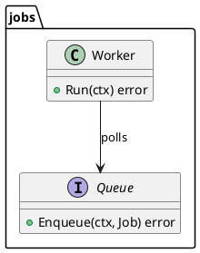

# Levels: what belongs where, and where to find it

Every level is a view of the ONE workspace model. A view never introduces
an element the model lacks; add the element to the model (with its source)
first, then include it.

## View keys

Keys become exported file names, so keep them stable and ASCII:

| Request | View type | Key |
|---|---|---|
| `1` | `systemContext <system>` (or `systemLandscape` when several in-house systems) | `L1` |
| `2` | `container <system>` | `L2` (more than one system: `L2-<system>`) |
| `3 <container>` | `component <system>.<container>` | `L3-<container>` |
| `3` holistic | one component view per significant container | `L3-<container>` each |
| `4 <package>` | plain PlantUML class diagram (not Structurizr) | file `docs/diagrams/code/<package>.puml` |
| `deployment [env]` | `deployment <system> <env>` | `Deployment` (more envs: `Deployment-<env>`) |
| `dynamic <flow>` / "sequence of <flow>" | `dynamic <scope>` or plain PlantUML sequence | `Dynamic-<Flow>` or file `docs/diagrams/sequence/<flow>.puml` |

If the workspace already uses other keys for these views, keep its keys.

## L1: system context

- In: people (roles, not names unless the repo names them), THE system as
  one box, every external system it touches (code hosts, cloud providers,
  DNS, registries, identity providers, payment, email, the ISP router...).
- Out: anything inside the system boundary.
- Evidence: README and architecture docs, IaC providers and backends
  (`provider` blocks, buckets, DNS records), CI workflows (who deploys
  where), SDK/client imports, env var names (names only, never values).

## L2: containers

- In: separately deployable or running units: services, workers, cluster
  workloads (one per operator or app, not per pod), databases, queues,
  VMs, hosts, managed services the system owns, CLIs and web apps users run.
- Out: libraries, packages, Kubernetes objects below a workload.
- Group related containers with `group "Name" { ... }` instead of adding
  boxes. Over ~20 elements: split into views with `include`/`exclude`
  (for example by namespace group, or "platform" vs "workloads").
- Evidence: `kubernetes/`, Helm values, Argo CD Applications, kustomize,
  `docker-compose*.yml`, `Dockerfile`s, `cmd/` mains, Procfiles, IaC
  compute resources (VMs, Cloud Run, functions), Terraform/OpenTofu.

## L3: components (one container)

- In: the major parts of ONE container: controllers, handlers, internal
  services, adapters, its config objects when they shape behaviour.
- Out: other containers' internals. Neighbours appear only as the
  containers or systems the components talk to.
- Evidence: the container's source tree (top-level packages and the
  types they export), its manifests (sub-deployments, sidecars), its
  config (CRDs, ConfigMaps by key name).

### Holistic C3

"C3 of X holistically" (or "all components", "every container's insides")
means a SET of views, not one diagram: one `component` view per
significant container, plus an index listing each view key, its
container, and its file. Significant = it has internal structure worth
showing (several internal parts or several outward dependencies); skip
thin wrappers and off-the-shelf images run unchanged. Count the candidate
containers first; when more than about 6 views would result, list them
and ask which to draw before producing any.

## L4: code

Structurizr has no code level. Draw L4 as a plain PlantUML class diagram
generated from real type and function names in ONE package (`go doc -all
./pkg`, `grep -n '^type\|^func'`, or the language's equivalent). At most
~12 types; show only exported types and the relationships between them
(fields, embedding, interface satisfaction, constructor returns). Use it
rarely.

Render with `scripts/render.sh --puml <file> <out-dir>`.

## Deployment

- In: deployment nodes (hosts, VMs, nodes, clusters, cloud regions)
  nested as they really nest; `containerInstance`/`softwareSystemInstance`
  for what runs on each; `infrastructureNode` for routers, load
  balancers, firewalls, DNS.
- Containment rules (firewall zones, network policies) are relationships
  or infrastructure nodes with the rule summarised in the description
  and the rule's file cited.
- Evidence: node and host inventory (Talos patches, Ansible inventory,
  Terraform VM resources, cloud provider resources), network config.

## Dynamic and sequence views

Pick one, and say which and why in the report:

- **Structurizr `dynamic` view** when every participant is an element in
  the model (person, system, container or component) and each step is an
  interaction between elements, e.g. "how a Dependabot PR reaches CI"
  across GitHub, the runners and the cluster. It stays one model, and
  `"plantuml.sequenceDiagram" "true"` in the view's `properties` renders
  it as a sequence diagram.
- **Plain PlantUML sequence diagram** (`docs/diagrams/sequence/<flow>.puml`)
  when the flow is finer-grained than the model: function calls, HTTP
  request/response pairs, token exchanges, retries, e.g. "a sign-in
  through rapt". Name each participant after the model element it lives
  in where one exists (`participant "API (container)"`), and cite source
  files per participant in `'` comments.
- Each step cites the code that performs it. A step inferred but not
  found is drawn with a `Unverified` tag (dynamic) or a `-[#c62828,dashed]->`
  arrow (plain sequence).
